<div align="center">

# Pixe

### Describe a vibe. Get a direction.

An AI moodboard and creative-direction tool. Type a sentence like "cozy autumn café brand, film grain, warm" and Pixe lays real, credited photos from Unsplash and Openverse on an infinite board, pulls out the palette, pairs Google Fonts, checks contrast and writes a one-page creative brief.

**[pixe.ewstudios.workers.dev](https://pixe.ewstudios.workers.dev)** · [The shared API](https://github.com/emwil23/ew-apps-api)


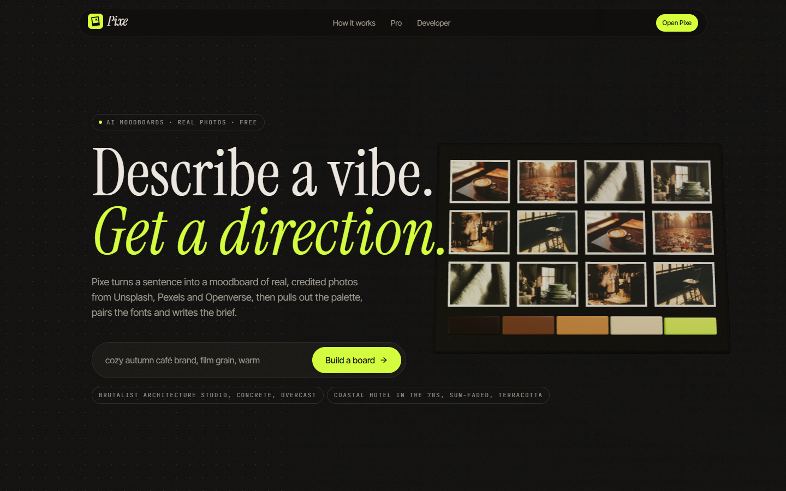

</div>

## The idea

Pixe began in 2021 as a React 17 photo search: type a word, get 30 Unsplash photos in a masonry grid. It had the Unsplash key in the source, no alt text (`alt={discription}`), and no credit for photographers. It also can't be rebuilt as it was: Unsplash's API rules say an app may not replicate Unsplash's core experience.

So the rebuild keeps the masonry feel and changes the job. Pixe is for the moment before a project starts, when a designer needs a direction rather than a photo. The board is the product; the photo libraries are raw material, and every photo keeps its credit.

| From                    | What Pixe takes                                                               |
| :---------------------- | :---------------------------------------------------------------------------- |
| Pinterest               | Boards, and "more like this" (the AI describes a photo, then searches for it) |
| Milanote and Are.na     | A freeform canvas with notes and groups                                       |
| Coolors and Adobe Color | Palette extraction, harmonies and WCAG contrast checks                        |
| Canva and Figma         | A brand kit: palette, fonts and brief together, exported as tokens            |
| Eagle                   | AI tags and alt text for every reference                                      |
| Freepik and Adobe Stock | Search by idea: a sentence becomes several keyword searches                   |

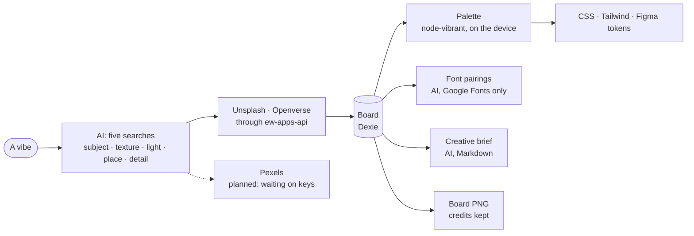

## A walk through

|                                                                                                                                                                                                                           |                                                                                                                                                                                                                                |
| :------------------------------------------------------------------------------------------------------------------------------------------------------------------------------------------------------------------------ | :----------------------------------------------------------------------------------------------------------------------------------------------------------------------------------------------------------------------------- |
| 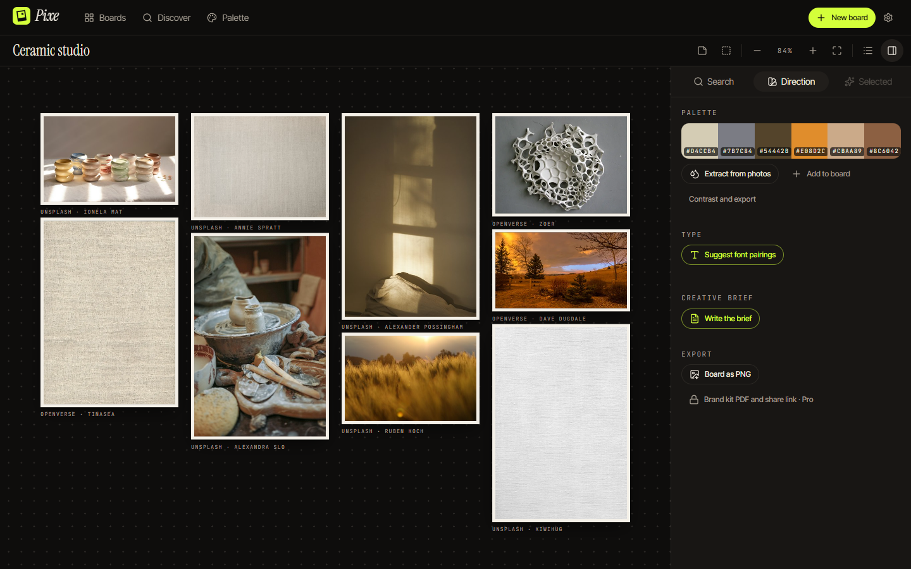                             | 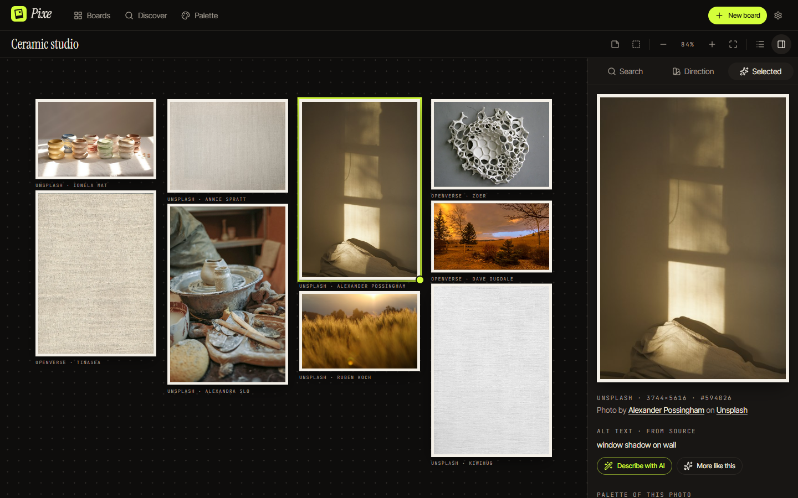 |
| **The board.** A sentence becomes up to fifteen photos from Unsplash and Openverse, laid out as masonry, with the palette already pulled. Drag, resize, group, add notes.                                                 | **Every print is credited.** The inspector shows the credit each source asks for, the licence for Openverse photos, real alt text, and "more like this".                                                                       |
| 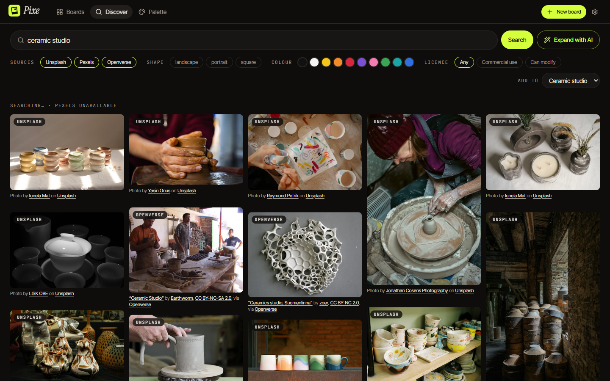 | 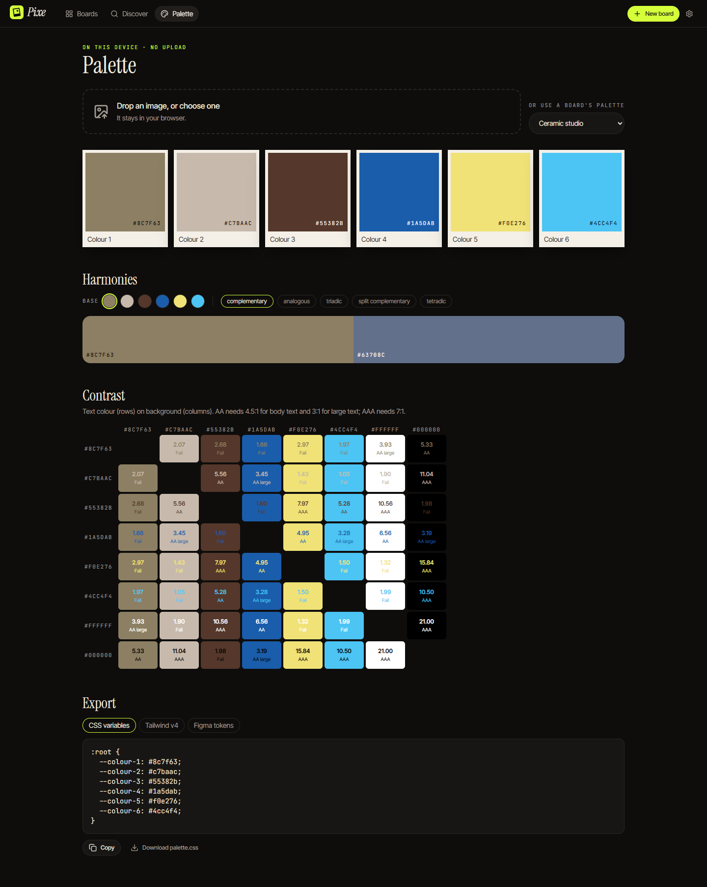                                    |
| **Discover.** Every library at once, results appearing as each one answers. "Expand with AI" turns an idea into searches.                                                                                                 | **Palette.** Drop any image (it never leaves the browser) or use a board's palette: harmonies, a WCAG grid, and export as CSS, Tailwind v4 or W3C design tokens for Figma.                                                     |
| 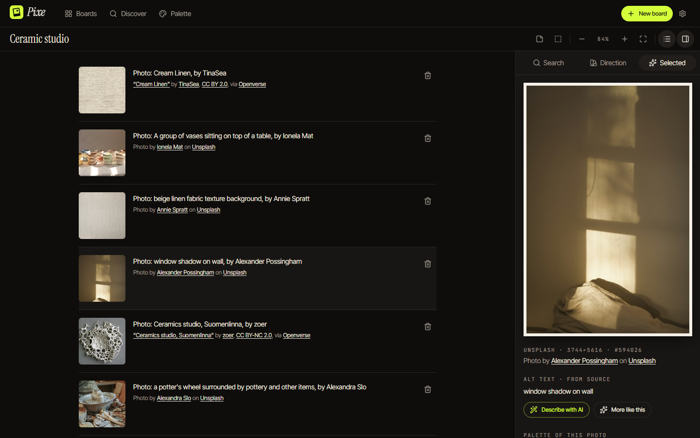                                                                  | 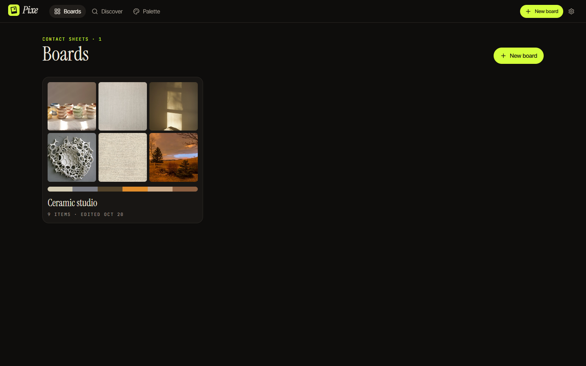                                                                           |
| **A list view of every board.** The same items in reading order, for screen readers and for checking credits at a glance.                                                                                                 | **Boards as contact sheets.** Six slots, the palette strip, the title in serif.                                                                                                                                                |
| 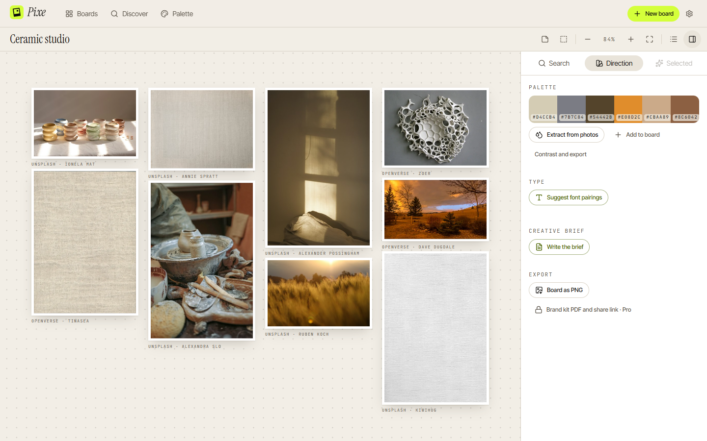                                                                                                                                | 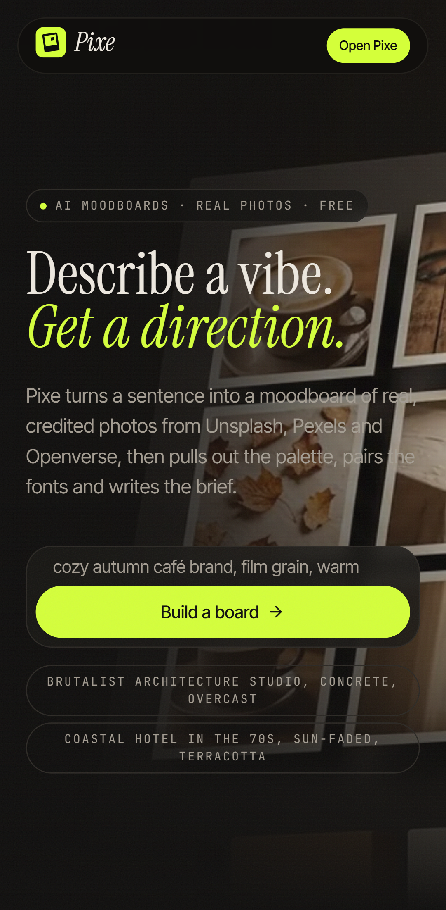                                                                                            |
| **Daylight theme.** Both themes pass WCAG AA on every page, checked by axe in CI.                                                                                                                                         | **Phone.** The board panels become bottom sheets; the landing page drops the 3D for a still.                                                                                                                                   |

The landing page tells the story in four beats (describe, curate, extract, share) while the art stays put beside the copy:

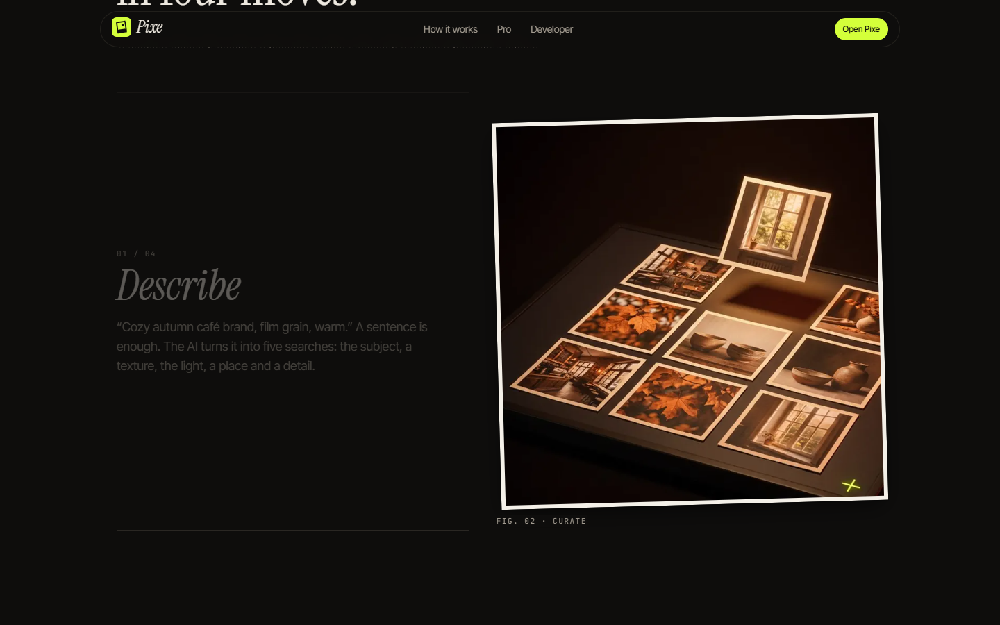

And the developer page, with the owner's own character:

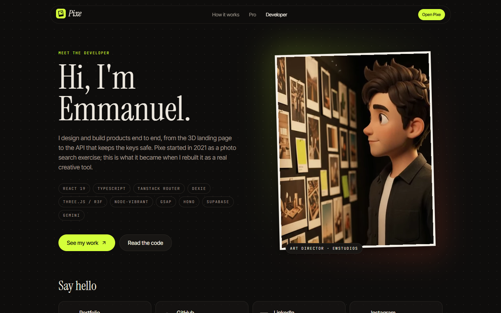

## How it is built

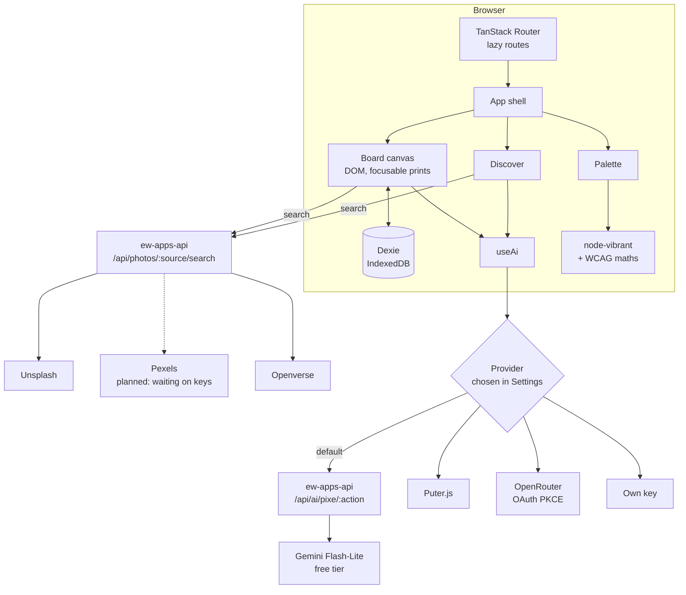

Building a board from a vibe, with every source searched at once:

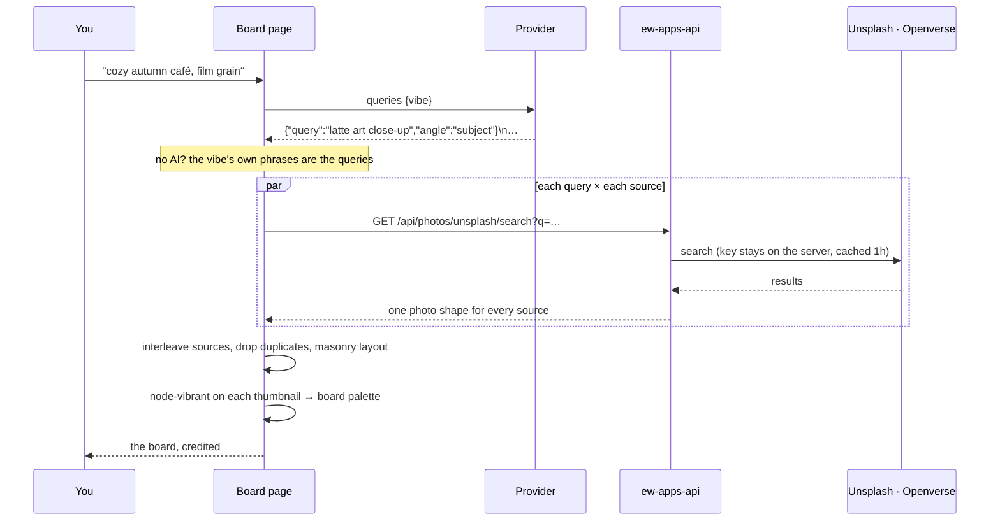

"Describe" is the one action that sends an image to the model, and only a public stock photo can go:

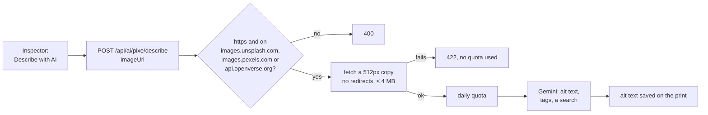

## Decisions worth explaining

- **Pexels is built but switched off.** The API, filters and credit line for Pexels are done and tested, but Pexels has paused new API keys. Without a key the API answers 503 for that source and Pixe searches the others; it switches on when a key goes into `ew-apps-api`'s `.env`, with no code change.
- **Not an Unsplash clone.** Unsplash's guidelines forbid replicating its core experience, so search lives inside a board, not on a home page of results. Pixe uses the image URLs each API returns (no re-hosting), reports downloads to Unsplash when a board is exported, links photographers with UTM tags, and shows each Openverse licence (a prominent Pexels link is ready for when Pexels is on). Openverse doesn't check licences, so the terms say to check before use.
- **The keys stay on the server.** The old app shipped its Unsplash key to every browser. Now `ew-apps-api` holds the keys, turns each source's JSON into one shape, and caches each search for an hour: anonymous Openverse allows 200 calls a day and Unsplash's demo tier 50 an hour, shared by everyone.
- **A DOM canvas, not a `<canvas>`.** The brief allowed tldraw (its licence needs a paid key for a commercial app with Pro) or react-konva. Konva draws pixels a screen reader can't see. Here every print is a real element in one transformed layer: it can be tabbed to, has alt text, moves with the arrow keys, and the board has a list view too. Pointer drag, a resize handle, pan, Ctrl+scroll and pinch zoom took about 350 lines.
- **Slow sources don't hold the page.** Openverse can take 40 seconds on a query it hasn't cached. Results merge in as each source answers, and the board build leaves out any source still searching after 12 seconds.
- **The AI sees only words and public stock photos.** Vibes, board text, colours, font names and stock photo URLs. Images you drop on the Palette page are read by node-vibrant in the browser and never sent anywhere. The privacy page says plainly that Google may read free-tier prompts.
- **One sign-in for every EWSTUDIOS app.** All the apps share one Supabase account and live under `ewstudios.workers.dev` as Cloudflare Workers serving static files. Supabase allows a single passkey domain per project, so a shared parent domain means a passkey saved in one app signs you in to the others. The emailed 6-digit code always works as the fallback. Sign-in exists only for the free AI server's daily quota; your boards stay in the browser.
- **The AI is a bonus, not a gate.** Without a provider, a board still builds from the vibe's own phrases, and the palette and contrast tools never use AI.
- **Model output is untrusted.** Font names must look like Google Fonts names before a stylesheet is loaded; AI alt text and tags are type-checked and capped before they are saved; the brief renders as text nodes, never HTML.
- **Prerender and hydrate, then 3D after first paint.** The public pages are rendered with React's own `renderToString` inside the built app, so phones see content before any JavaScript. The 3D board loads when the page is idle, on wide screens with a real GPU, and stops rendering off screen. Fonts aren't preloaded and below-the-fold media waits until it nears the screen, so nothing competes with the first paint.

## Two versions

| Version           | Concept                                                                                                            | Why it changed                                                                                                                     |
| :---------------- | :----------------------------------------------------------------------------------------------------------------- | :--------------------------------------------------------------------------------------------------------------------------------- |
| v1 (Oct–Dec 2021) | React 17 Unsplash search: 30 results in a masonry grid, each opening in a new tab, and a slide-out developer panel | The API key sat in the source, images had no alt text and photographers no credit, and Unsplash's rules forbid rebuilding Unsplash |
| **v2 (Oct 2026)** | An AI moodboard and creative-direction tool: boards, palette, fonts, brief, with stock photos as raw material      | Shipped                                                                                                                            |

## How it was made

Built in conversation with [Claude Code](https://claude.com/claude-code), which wrote and tested the code. The design direction ("a light table in a darkroom") came from Awwwards references (The Lookback, WINDOWS, OFFFForum, KINORIA; see [docs/design-brief.md](docs/design-brief.md)). The art and clips were generated in Google Flow (Nano Banana Pro and Omni 1.1 Flash); [docs/assets.md](docs/assets.md) lists every prompt, and the landing page labels its art as illustration, never stock. The logo and icons are SVG.

## Run it

```bash
npm install
```

```bash
npm run dev
```

```bash
npm test
```

```bash
npm run e2e
```

Node 24. Copy `.env.example` to `.env` and point `VITE_API_URL` at a running [ew-apps-api](https://github.com/emwil23/ew-apps-api) (with `UNSPLASH_ACCESS_KEY` and `PEXELS_API_KEY` in its own `.env`; Openverse needs no key). Pexels has paused new API keys for now; a source without a key reports itself unavailable and Pixe searches the others. Without an API the app still opens and keeps your boards, but can't search. `npm run build` also prerenders the public pages, so it needs Playwright's Chromium (`npx playwright install chromium`). `npm run e2e` builds against a made-up API host and answers every search and image itself, so it needs no keys or network; it runs the flows and axe on every page in both themes. CI adds lint, typecheck and Lighthouse (≥ 0.95 in every category). Deploy with `VITE_API_URL=https://ewandtina-d9aa187632ca.herokuapp.com npm run build && npx wrangler deploy` (config in `wrangler.jsonc`).

`node scripts/screenshots.mjs` retakes the pictures in `docs/` with real searches, against a build served on an origin the API allows.

## Where things are

```
src/
├─ main.tsx              router.load(), then hydrate or render
├─ router.tsx            every route, lazily loaded
├─ index.css             design tokens for both themes, self-hosted display fonts
├─ lib/                  board model (db, board, build), photos and credits, palette, colour maths, fonts
├─ ai/                   actions + templates, providers, JSON Lines, PKCE, Supabase sign-in
├─ hooks/                multi-source search
├─ components/board/     Canvas, ItemView, Inspector, DirectionPanel, SearchPanel, BoardList
├─ components/           app shell, new-board dialog, photo grid, credits, empty states
├─ landing/              3D hero board, four-beat story, smooth scroll
└─ pages/                Landing, Dashboard, Board, Discover, Palette, Settings, Developer, Pro, Legal, 404
scripts/
├─ prerender.mjs         static HTML for the public pages
└─ screenshots.mjs       the README pictures
e2e/                     Playwright flows with a mocked API, and axe checks
docs/                    brief, design brief, asset list, screenshots
```

<div align="center">
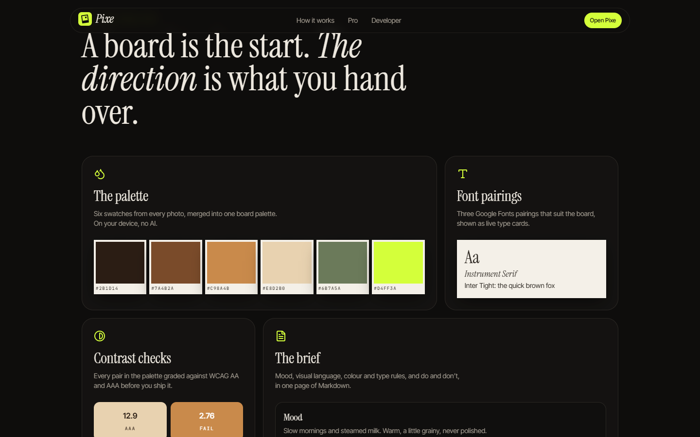

Made with ♥ by EWSTUDIOS

</div>
